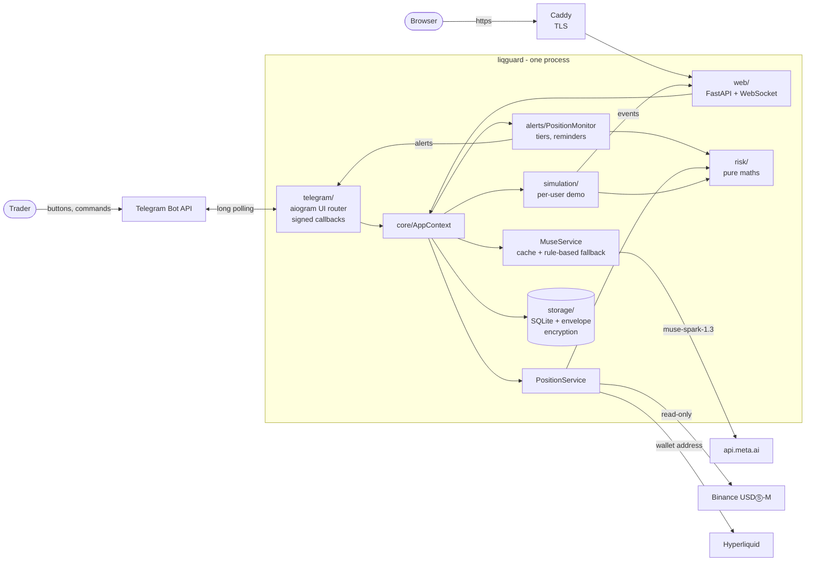

# LiqGuard 🛡️

**A Telegram bot and web dashboard that warns perpetual-futures traders before liquidation, tells
them which position to handle first, and works out the cheapest way to rescue it. Meta Muse
writes every recommendation in plain English or 繁體中文.**

Live dashboard: **<https://152-42-176-155.sslip.io>** (public demo, no login needed; sign in with
`/dashboard` from the bot to see your own book).

## The problem

Leveraged perp traders get liquidated in their sleep. Exchange apps show a liquidation price, but
they don't say:

- how close each position really is, once cross-margin wallet effects and funding are counted;
- which of five positions to save first when the market moves against all of them;
- whether a stop-loss would fire before the liquidation engine, or whether one normal wick would
  liquidate the position;
- what saving it costs: adding margin, cutting size or hedging, with fees and 24 h funding included.

The alert that matters arrives at 3 a.m. as a push notification that says "margin ratio 92%". By
the time the trader works out what to do, the position is gone.

LiqGuard watches the positions, does that maths deterministically, and sends one clear
recommendation with buttons to act on it.

## Features

| | Feature | What it does |
|---|---|---|
| 🏠 | **Inline-button menu** | Everything is a tap away from `/start`. Every slash command also has a button, and a test fails if one doesn't |
| 📊 | **Risk overview** | Muse's one-line summary, overall risk, the closest position, margin needed to get back to safety, handling order, plus stop-loss, one-wick and ADL flags |
| 🛡 | **Stop-loss check** | Reads open orders and flags positions with no stop, a stop beyond the liquidation price, or a stop so close that a wick beats it. Each position gets a computed fix |
| 🤖 | **Ask Muse** | Preset questions (risk, what to do first, PnL) or `/ask` with any question, answered from the user's own positions |
| 🛟 | **Rescue calculator** | Add margin, reduce or hedge, side by side: new liquidation price, distance, fees, realized loss, 24 h funding, capital needed, and the cheapest option that reaches the target |
| 💸 | **Funding & fees** | Next funding payment, the drift of the liquidation distance at the current rate, and the fee to close |
| 🚨 | **Alerts** | Warning, critical and emergency tiers (adaptive: wider at weekends, in thin hours and on wick-heavy coins), stop-loss, pre-funding and ADL alerts. Every alert has **🚑 Handle this first**, **✅ I'm awake** and **😴 Snooze 30 min**; wake-up reminders repeat until acknowledged |
| 🧪 | **Stress test & triage** | The market drop that liquidates a whole cross wallet when everything falls together, and an urgency ranking across positions |
| 🌐 | **English / 繁體中文** | Per-user language for every message, button and Muse answer; the dashboard has an **EN / 中文** toggle |
| 🖥️ | **Web dashboard** | <https://152-42-176-155.sslip.io>: live positions, the rescue simulator, quick reports, alert settings and account binding. It uses the same Muse service as the bot, with live updates over WebSocket |
| 🎬 | **Demo mode** | A deterministic market simulation (a mixed book, or five correlated longs in one wallet) that drives every feature without an exchange account |

Supported venues: **Binance USDⓈ-M Futures** (read-only API key) and **Hyperliquid** (wallet
address only).

## How we use Meta Muse

LiqGuard uses **Meta Muse, model `muse-spark-1.3`**, through the OpenAI-compatible API at
`https://api.meta.ai/v1` (`META_MODEL` and `META_API_BASE` override them). The division of labour
is strict:

- **The numbers come from code.** Liquidation prices, distances, margin to add, rescue costs and
  stop gaps are computed in `liqguard/risk/` (pure Python, no I/O).
- **Muse writes the words and makes the choice.** It explains the numbers, picks among the options
  the code computed, and answers in the reader's language.
- **Every answer is validated** before it is shown. LiqGuard asks for JSON (`response_format:
  json_object`) and rejects an answer that names the wrong symbol, quotes an amount that isn't in
  the plan, or picks a fix that wasn't offered.

Every surface leads with exactly one line, `💡 <recommendation> · ✦ Muse`.

### Where Muse appears

All channels call one `MuseService` (`liqguard/core/muse_service.py`, held by `AppContext.muse`),
so Telegram and the dashboard share one set of inputs, one cache and the same words.

| `MuseService` method | What Muse writes | In the Telegram bot | On the web dashboard |
|---|---|---|---|
| `portfolio()` | One-sentence portfolio summary naming the position to handle first | 📊 Risk overview, `/risk` | Hero banner and the signed-in account view |
| `suggestion()` | Advice for the position triage puts first | (the overview's 🚑 Rescue X first) | Account view |
| `explain_risk_now()` | The add-margin / reduce advice in plain words | Warning, critical and emergency alerts | Alert timeline for live positions |
| `rescue()` / `explain_rescue()` | Which of add margin / reduce / hedge to take, and each option's pros and cons | 🛟 Rescue sim, 🚑 Handle this first | Rescue simulator panel |
| `explain_stop_fix_now()` | What is wrong with the stop and which computed fix to apply | Stop-loss alerts, 🛑 Stop-loss check | Stop-loss panel |
| `tool_note()` | The first line of the rescue and stop-loss quick reports | Per-position tool buttons | Quick-report dialog |
| `answer_now()` | An answer to a question about the user's own positions | 🤖 Ask Muse presets, `/ask <question>` | — |
| `parse_screenshot()` | Position fields read from an exchange screenshot | Send a photo to the bot | — |

The demo simulation's advice cards, rescue panels and stop-loss alerts use the same
`MetaLLMClient` and cache, in Telegram and on the dashboard.

### Rule-based first, Muse when it arrives

Muse never holds up a message:

1. **Instant fallback.** Each `*_now` method returns an `Instant(result, pending, live)`.
   `result` is shown at once: either a cached Muse answer, or deterministic rule-based text
   tagged `✦ Muse (mock)` / `✦ Muse（模擬）`. `pending` resolves to Muse's answer.
2. **Edited in place.** When Muse answers, Telegram edits the same message, and the dashboard
   swaps the text from the WebSocket events `advice_update`, `account_muse`, `rescue_muse` and
   `report_muse`. The tag becomes `✦ Muse`.
3. **Bounded.** Each answer has a 15 s budget (`META_TIMEOUT`), including one retry with a larger
   token budget (`muse-spark-1.3` reasons before answering). If Muse fails or times out, the
   rule-based text stays. Failures include HTTP errors, empty or truncated answers, invalid JSON
   and answers that fail validation.
4. **Cached.** Validated answers are cached per input (portfolio snapshot, rescue plan, stop check)
   for 10 minutes, and concurrent callers share one request. If `/risk` already summarized a book,
   the dashboard reuses that summary with no new call.
5. **Honest.** Without `META_API_KEY`, a deterministic mock answers and is labelled as mock. The
   dashboard's Muse pill reads *Muse · live* only when the last answer was actually used.

## Architecture



Business logic lives in framework-free packages (`risk/`, `models/`, `alerts/`, `core/`).
Telegram and the dashboard are thin delivery layers; `test_architecture.py` forbids framework
imports below them, and import cycles anywhere. Every piece of per-user state is keyed by the
owner's Telegram id, and `test_isolation.py` checks each kind with two users.

## Security

- **Read-only access only.** Binance takes an API key with *Enable Reading* only. On `/bind`,
  LiqGuard asks Binance what that key may do, and rejects it if it can trade, withdraw or
  transfer, or if its permissions can't be verified. The mainnet adapter refuses any non-GET
  request. Hyperliquid takes a **wallet address only**; no key is ever needed. Anything that looks
  like a private key or seed phrase is refused and deleted.
- **Envelope encryption.** A master key (`LIQGUARD_MASTER_KEY`, or a mode-600 key file outside
  the repo) wraps a random per-user data key. Each user's credentials are encrypted with their own
  data key, so a ciphertext copied to another user's row fails to decrypt. Master keys can be
  rotated, and SQLite runs with `secure_delete`.
- **Secrets never echo.** The bot deletes the message holding a key as soon as it reads it. Status
  screens show masked hints only. A log filter scrubs bot tokens, API keys, signatures and Fernet
  ciphertexts.
- **Nothing trades on mainnet.** Optional protective actions (add margin, confirmed by the user,
  with a kill switch and daily caps) run only on a separate Binance **testnet** binding, and are
  off by default.
- **Dashboard login.** Sign-in uses a one-time `/dashboard` link (stored hashed, expires in 5 min)
  or the Telegram Login Widget. Sessions use HMAC-signed `HttpOnly` cookies. Requests need a CSRF
  header and a same-origin check, and `/dashboard revoke` signs out every device.

## Setup

### Local

Requires Python 3.11+.

```bash
git clone <this repo> liqguard && cd liqguard
pip install -e ".[dev]"
cp .env.example .env        # placeholders only; fill in TELEGRAM_BOT_TOKEN, optionally META_API_KEY
liqguard                    # bot + monitor; add LIQGUARD_DASHBOARD=true for the dashboard
```

Dashboard only (no Telegram token needed; the public demo runs on simulated data):

```bash
python3 -m liqguard.web.run --port 8765     # http://127.0.0.1:8765
```

Without `META_API_KEY`, Muse runs in deterministic mock mode, so every feature still works.
`.env.example` documents every variable; `.env` is git-ignored.

### Deploy: Docker + Caddy (the documented path)

One container runs the bot and the dashboard in a single process. All state (database, master
key, audit log) lives on a volume, and Caddy terminates https with an automatic Let's Encrypt
certificate. Step by step, including firewall and the Telegram Login Widget:
[DEPLOY.md](DEPLOY.md).

```bash
cp .env.example .env && chmod 600 .env   # TELEGRAM_BOT_TOKEN, LIQGUARD_DOMAIN, LIQGUARD_PUBLIC_URL=https://<domain>
docker compose --profile https up -d --build
curl https://<domain>/healthz            # {"status":"ok"}
```

### Deploy: systemd + Caddy (without Docker)

```ini
# /etc/systemd/system/liqguard.service
[Unit]
Description=LiqGuard Telegram bot and dashboard
After=network-online.target
Wants=network-online.target

[Service]
User=liqguard
WorkingDirectory=/opt/liqguard
EnvironmentFile=/opt/liqguard/.env
Environment=LIQGUARD_DATA_DIR=/var/lib/liqguard
Environment=LIQGUARD_DASHBOARD=true
Environment=LIQGUARD_DASHBOARD_HOST=127.0.0.1
Environment=LIQGUARD_DASHBOARD_PORT=8765
StateDirectory=liqguard
StateDirectoryMode=0700
ExecStart=/opt/liqguard/.venv/bin/liqguard
Restart=on-failure
NoNewPrivileges=true

[Install]
WantedBy=multi-user.target
```

```
# /etc/caddy/Caddyfile
liqguard.example.com {
	encode zstd gzip
	reverse_proxy 127.0.0.1:8765
}
```

Then run `systemctl enable --now liqguard` and `systemctl reload caddy`. WebSockets pass through
`reverse_proxy` with no extra config.

Whichever path you choose, run **exactly one instance per bot token**. Telegram hands each update
to one poller only, so a second instance silently swallows button presses. Use a separate
BotFather token for development.

## Tests

```bash
python3 -m pytest -q                     # 929 passed, 3 skipped (the skips are opt-in live-API and browser checks)
python3 scripts/prerelease_check.py      # 28 end-to-end scenarios through the production dispatcher, in both languages
python3 -m ruff check liqguard scripts
```

The suite covers:

- **Maths:** liquidation maths against hand-derived prices, funding, rescue costs, wick stress,
  stop-loss fixes, triage, and the correlated stress test.
- **Muse:** the live path against a mocked HTTP layer (timeouts, truncation, invalid JSON,
  validation, cache), and a check that Telegram and the dashboard call the same `MuseService`.
- **Telegram UI:** the callback codec (tampered, expired and other users' buttons), a crawl of
  every menu path in both languages, and the rule that every slash command has a button.
- **Isolation and security:** per-user isolation with two users, envelope encryption and
  rotation, login, CSRF and WebSocket auth.
- **Web:** dashboard browser tests (Playwright).

Every release must also pass `scripts/prerelease_check.py`. It drives the real aiogram
`Dispatcher` with real `Update` objects and asserts that no demo message is sent after ✅ / 😴 /
⏹. See [CONTRIBUTING.md](CONTRIBUTING.md).

The full reference (formulas, every command, the dashboard API, all environment variables) is in
[docs/technical-reference.md](docs/technical-reference.md). The 3-minute demo walkthrough is in
[docs/demo-script.md](docs/demo-script.md).

## Roadmap

- [x] Binance USDⓈ-M and Hyperliquid, read-only
- [x] True cross-margin liquidation price, live funding, rescue calculator
- [x] Wick stress test, adaptive tiers, stop-loss check, ADL lights, wake-up reminders
- [x] Priority triage, position sizing, correlated portfolio stress test
- [x] Meta Muse on every surface, with rule-based fallback, validation and a shared cache
- [x] English / 繁體中文 everywhere; web dashboard with per-user login
- [x] Tier-1 protective actions on testnet (user-confirmed, kill switch)
- [ ] Rolling correlations and betas from klines instead of fixed factors
- [ ] Portfolio-margin / multi-asset mode; Binance Hedge Mode positions as input
- [ ] Persist pending actions and the kill switch across restarts
- [ ] OKX and Bybit
- [ ] Rules-based automation (tier 2), opt-in and testnet-first

## License

[MIT](LICENSE) © 2026 CryptoCat007

## Disclaimer

LiqGuard is a monitoring and advisory tool, not financial advice. Trading perpetual futures
carries significant risk of loss. Protective actions are testnet-only.
